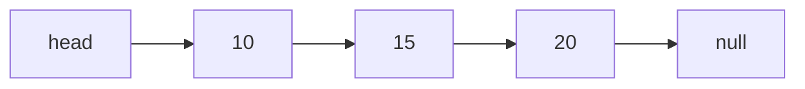
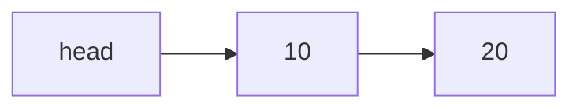
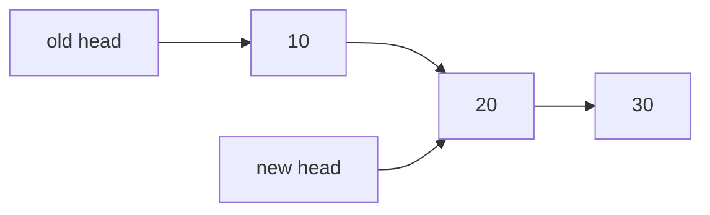
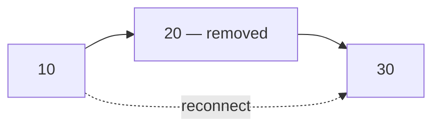

---

---

# Data Structures and Algorithms

### Lesson 3: Stacks, Queues, and Linked Lists

**Prepared By:** Jackson S. Soriano, MIT  

---

# Learning Outcomes

After this lesson, students should be able to:

- explain LIFO and implement a stack;
- explain FIFO and implement a queue;
- use priority and circular queue behavior; and
- create and modify linked-list nodes.

---

# Lesson Roadmap

| Chapter | Main Structure | Central Idea |
| --- | --- | --- |
||
| 3 | Stack | Last In, First Out |
| 4 | Queue | First In, First Out |
| 5 | Linked List | Nodes connected through references |

---


# Chapter 3

## Stacks

Last In, First Out

---

# What Is a Stack?

A **stack** is an ordered collection that follows **LIFO**.

> The last item added is the first item removed.

| Stack Part | Meaning |
| --- | --- |
| Top | Where items enter and leave |
| Base | Where the oldest item remains |

Examples:

- pile of books or trays;
- function and method calls;
- undo operations; and
- backtracking.

---

# Core Stack Operations

| Method | Operation |
| --- | --- |
| `push(element)` | Add to the top |
| `pop()` | Remove and return the top |
| `peek()` | Read the top without removing it |
| `isEmpty()` | Check whether no items exist |
| `size()` | Count the items |
| `clear()` | Remove all items |

Only the top is used for insertion and removal.

---

# Stack Class: Storage and Main Methods

```js
class Stack {
  constructor() {
    this.items = [];
  }

  push(element) {
    this.items.push(element);
  }

  pop() {
    return this.items.pop();
  }

  peek() {
    return this.items[this.items.length - 1];
  }
}
```

The internal array stores the stack values.

---

# Stack Class: Helper Methods

```js
class Stack {
  // constructor, push, pop, and peek omitted

  isEmpty() {
    return this.items.length === 0;
  }

  size() {
    return this.items.length;
  }

  clear() {
    this.items = [];
  }

  toString() {
    return this.items.toString();
  }
}
```

These methods inspect or reset the structure.

---

# Using the Stack

```js
const stack = new Stack();

stack.push(5);
stack.push(8);
stack.push(11);
stack.push(15);

console.log(stack.peek()); // 15
console.log(stack.size()); // 4

console.log(stack.pop());  // 15
console.log(stack.pop());  // 11
console.log(stack.toString()); // 5,8
```

`15` leaves first because it entered last.

---

# Problem: Decimal to Binary

Convert a decimal number by repeatedly dividing by `2`.

| Division | Quotient | Remainder |
| --- | ---: | ---: |
| `10 ÷ 2` | 5 | 0 |
| `5 ÷ 2` | 2 | 1 |
| `2 ÷ 2` | 1 | 0 |
| `1 ÷ 2` | 0 | 1 |

Remainders are generated as `0, 1, 0, 1`.

Popping them from a stack produces `1010`.

---

# Decimal-to-Binary Algorithm

```js
function divideBy2(decimalNumber) {
  const remainders = new Stack();
  let number = decimalNumber;
  let binary = '';

  while (number > 0) {
    remainders.push(Math.floor(number % 2));
    number = Math.floor(number / 2);
  }

  while (!remainders.isEmpty()) {
    binary += remainders.pop().toString();
  }

  return binary;
}

console.log(divideBy2(10)); // 1010
```

---

# General Base Converter

```js
function baseConverter(decimalNumber, base) {
  const remainders = new Stack();
  const digits = '0123456789ABCDEF';
  let number = decimalNumber;
  let result = '';

  while (number > 0) {
    remainders.push(Math.floor(number % base));
    number = Math.floor(number / base);
  }

  while (!remainders.isEmpty()) {
    result += digits[remainders.pop()];
  }

  return result;
}
```

Supports bases `2` through `16`.

---

# Why the Stack Solves It

The conversion process generates the least significant digit first.

The required output needs the most significant digit first.

```text
Generated: 0 → 1 → 0 → 1
Needed:    1 → 0 → 1 → 0
```

LIFO automatically reverses the order.

Other classic stack problems:

- balanced parentheses; and
- Tower of Hanoi.

---

# Chapter 3 Key Points

- A stack follows LIFO.
- Items enter and leave through the top.
- `push()` and `pop()` enforce stack behavior.
- `peek()` reads without removing.
- Stacks help reverse processing order.
- Base conversion is a practical stack application.

---

<!-- _class: lead -->

# Chapter 4

## Queues

First In, First Out

---

# What Is a Queue?

A **queue** is an ordered collection that follows **FIFO**.

> The first item added is the first item removed.

- New items enter at the **back** or **tail**.
- Existing items leave from the **front**.
- Later arrivals wait behind earlier arrivals.

Examples include people waiting in line and documents waiting to be printed.

---

# Stack vs. Queue

| Feature | Stack | Queue |
| --- | --- | --- |
| Rule | LIFO | FIFO |
| Add at | Top | Back |
| Remove from | Top | Front |
| Add method | `push()` | `enqueue()` |
| Remove method | `pop()` | `dequeue()` |

The structures store collections but control removal differently.

---

# Queue Class

```js
class Queue {
  constructor() {
    this.items = [];
  }

  enqueue(element) {
    this.items.push(element);
  }

  dequeue() {
    return this.items.shift();
  }

  front() {
    return this.items[0];
  }
}
```

`push()` adds at the back; `shift()` removes from the front.

---

# Queue Helper Methods

```js
class Queue {
  // constructor, enqueue, dequeue, and front omitted

  isEmpty() {
    return this.items.length === 0;
  }

  size() {
    return this.items.length;
  }

  toString() {
    return this.items.toString();
  }
}
```

| Method | Result |
| --- | --- |
| `front()` | Next item to leave |
| `size()` | Number of waiting items |
| `isEmpty()` | Whether the queue has no items |

---

# Using the Queue

```js
const queue = new Queue();

queue.enqueue('John');
queue.enqueue('Jack');
queue.enqueue('Camila');

console.log(queue.front()); // John
console.log(queue.size());  // 3

console.log(queue.dequeue()); // John
console.log(queue.dequeue()); // Jack
console.log(queue.toString()); // Camila
```

John leaves first because John entered first.

---

# Priority Queue

A **priority queue** considers priority when arranging elements.

Examples:

- hospital patients prioritized by condition;
- airline passengers prioritized by boarding group.

The chapter implements a **minimum priority queue**:

- smaller number = higher priority;
- equal priorities keep arrival order; and
- higher-priority elements are inserted nearer the front.

---

# Priority Queue: `enqueue()`

```js
enqueue(element, priority) {
  const newItem = { element, priority };
  let added = false;

  for (let i = 0; i < this.items.length; i++) {
    if (newItem.priority < this.items[i].priority) {
      this.items.splice(i, 0, newItem);
      added = true;
      break;
    }
  }

  if (!added) {
    this.items.push(newItem);
  }
}
```

The loop searches for the correct insertion position.

---

# Priority Queue Example

```js
const priorityQueue = new PriorityQueue();

priorityQueue.enqueue('John', 2);
priorityQueue.enqueue('Jack', 1);
priorityQueue.enqueue('Camila', 1);

priorityQueue.print();
```

Output:

```text
Jack - 1
Camila - 1
John - 2
```

Jack remains before Camila because Jack arrived first.

---

# Circular Queue: Hot Potato

Queue rotation moves the front player to the back.

```js
function hotPotato(names, passes) {
  const queue = new Queue();

  for (const name of names) {
    queue.enqueue(name);
  }

  while (queue.size() > 1) {
    for (let i = 0; i < passes; i++) {
      queue.enqueue(queue.dequeue());
    }

    console.log(`${queue.dequeue()} was eliminated.`);
  }

  return queue.dequeue();
}
```

---

# Running the Hot Potato Game

```js
const names = [
  'John', 'Jack', 'Camila', 'Ingrid', 'Carl'
];

const winner = hotPotato(names, 7);
console.log(`The winner is: ${winner}`);
```

Each round performs two queue operations:

1. Rotate players with `dequeue()` and `enqueue()`.
2. Remove the player holding the potato.

The process repeats until one player remains.

---

# JavaScript Task Queues

A browser tab handles many tasks:

- execute JavaScript;
- render HTML;
- process mouse clicks and keyboard input; and
- handle asynchronous requests.

An **event loop** processes tasks from a queue.

This shows how a basic data structure supports real software behavior.

---

# Chapter 4 Key Points

- A queue follows FIFO.
- Items enter at the back and leave from the front.
- A priority queue considers urgency or importance.
- Equal priorities can preserve arrival order.
- Circular behavior can be simulated through rotation.
- JavaScript task processing uses queue concepts.

---

<!-- _class: lead -->

# Chapter 5

## Linked Lists

Values stored in connected nodes

---

# Why Use a Linked List?

Arrays provide convenient indexed access, but inserting or removing in the middle requires shifting elements.

A **linked list** stores values in connected nodes.

Each node contains:

- the value or `element`; and
- a reference or `next` link.

The list can grow or shrink as nodes are added or removed.

---

# Array vs. Linked List

| Feature | Array | Linked List |
| --- | --- | --- |
| Storage | Indexed values | Connected nodes |
| Direct access | Yes | No |
| Access middle | Use index | Traverse from `head` |
| Insert/remove middle | Shift elements | Change references |
| Main concern | Index management | Link management |

Use a linked list when additions and removals are frequent.

---

# Node and Head

```js
class Node {
  constructor(element) {
    this.element = element;
    this.next = null;
  }
}
```



`head` stores the reference to the first node.

---

# LinkedList Structure

```js
class LinkedList {
  constructor() {
    this.length = 0;
    this.head = null;
  }

  // Methods to implement:
  // append(element)
  // insert(position, element)
  // removeAt(position)
  // remove(element)
  // indexOf(element)
  // isEmpty(), size(), toString()
}
```

`length` counts nodes; `head` begins the traversal.

---

# Appending a Node

```js
append(element) {
  const node = new Node(element);

  if (this.head === null) {
    this.head = node;
  } else {
    let current = this.head;

    while (current.next !== null) {
      current = current.next;
    }

    current.next = node;
  }

  this.length++;
}
```

The last node is found when `current.next` is `null`.

---

# Inserting at the Beginning

Before insertion:



Code:

```js
const node = new Node(5);
node.next = this.head;
this.head = node;
this.length++;
```

The new node points to the old head before becoming the new head.

---

# Inserting in the Middle

Keep references to both sides of the insertion point.

```js
let current = this.head;
let previous = null;
let index = 0;

while (index < position) {
  previous = current;
  current = current.next;
  index++;
}

node.next = current;
previous.next = node;
```

Connect the new node to `current` before redirecting `previous.next`.

---

# Complete `insert()` Method

```js
insert(position, element) {
  if (position < 0 || position > this.length) return false;

  const node = new Node(element);
  let current = this.head;

  if (position === 0) {
    node.next = current;
    this.head = node;
  } else {
    let previous = null;
    let index = 0;
    while (index++ < position) {
      previous = current;
      current = current.next;
    }
    node.next = current;
    previous.next = node;
  }

  this.length++;
  return true;
}
```

---

# Removing the First Node

```js
let current = this.head;
this.head = current.next;
this.length--;

return current.element;
```



Moving `head` skips the original first node.

---

# Removing a Middle Node

After locating the target node:

```js
previous.next = current.next;
```



The previous node is connected directly to the node after `current`.

---

# Complete `removeAt()` Method

```js
removeAt(position) {
  if (position < 0 || position >= this.length) return null;

  let current = this.head;

  if (position === 0) {
    this.head = current.next;
  } else {
    let previous = null;
    let index = 0;
    while (index++ < position) {
      previous = current;
      current = current.next;
    }
    previous.next = current.next;
  }

  this.length--;
  return current.element;
}
```

---

# Searching by Value

```js
indexOf(element) {
  let current = this.head;
  let index = 0;

  while (current !== null) {
    if (current.element === element) {
      return index;
    }

    current = current.next;
    index++;
  }

  return -1;
}
```

Searching requires traversal from `head`.

---

# Reusing Methods

Remove by value by combining existing operations.

```js
remove(element) {
  const position = this.indexOf(element);
  return this.removeAt(position);
}
```

Other helper methods:

```js
isEmpty() {
  return this.length === 0;
}

size() {
  return this.length;
}
```

Code reuse reduces duplicated logic.

---

# Linked List in Action

```js
const list = new LinkedList();

list.append(15);
list.append(10);
list.insert(1, 12);

console.log(list.toString()); // 15, 12, 10
console.log(list.indexOf(12)); // 1

list.remove(12);
console.log(list.toString()); // 15, 10
console.log(list.size());     // 2
```

Trace the values of `head`, `current`, and `previous` while debugging.

---

# Doubly Linked List

Each node has two references.

```js
class DoublyNode {
  constructor(element) {
    this.element = element;
    this.next = null;
    this.prev = null;
  }
}
```

The list keeps both ends:

```js
this.head = null;
this.tail = null;
```

It can be traversed forward or backward.

---

# Doubly Linked List: Insert at End

```js
const node = new DoublyNode(element);

if (this.head === null) {
  this.head = node;
  this.tail = node;
} else {
  node.prev = this.tail;
  this.tail.next = node;
  this.tail = node;
}

this.length++;
```

Both directions must remain correct:

- old tail’s `next` → new node;
- new node’s `prev` → old tail; and
- `tail` → new node.

---

# Doubly Linked List: Remove at End

```js
const current = this.tail;
this.tail = current.prev;

if (this.tail === null) {
  this.head = null;
} else {
  this.tail.next = null;
}

this.length--;
return current.element;
```

Having a `tail` avoids traversing from `head` to reach the final node.

---

# Circular Linked Lists

In a circular singly linked list:

```js
tail.next = head;
```

In a circular doubly linked list:

```js
tail.next = head;
head.prev = tail;
```

There is no final `null` link. Traversal must stop when it returns to the starting node.

---

# Chapter 5 Key Points

- A linked list is built from connected nodes.
- `head` identifies the first node.
- Singly linked nodes point only to `next`.
- Doubly linked nodes use both `next` and `prev`.
- A circular list reconnects the tail to the head.
- Correct reference order prevents broken links.

---

# Comparing the Four Structures

| Structure | Main Rule | Main Strength |
| --- | --- | --- |
| Array | Indexed sequence | Direct access and built-in methods |
| Stack | LIFO | Reverse or recent-first processing |
| Queue | FIFO | Arrival-order processing |
| Linked List | Connected nodes | Insert/remove through link changes |

The best structure depends on how data must be accessed and changed.

---


# Final Reminder

Do not memorize code without tracing it.

For every operation, ask:

1. Where does the new value enter?
2. Where does a value leave?
3. Which index or reference changes?
4. What is the stopping condition?
5. What output should the code produce?

**Understanding the movement of data is the heart of data structures.**

